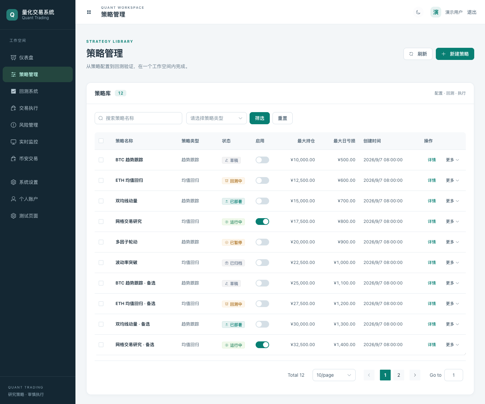
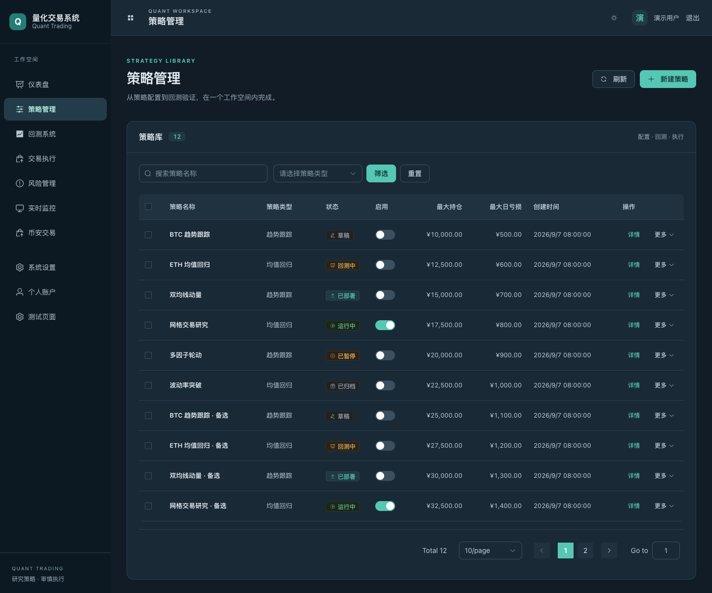
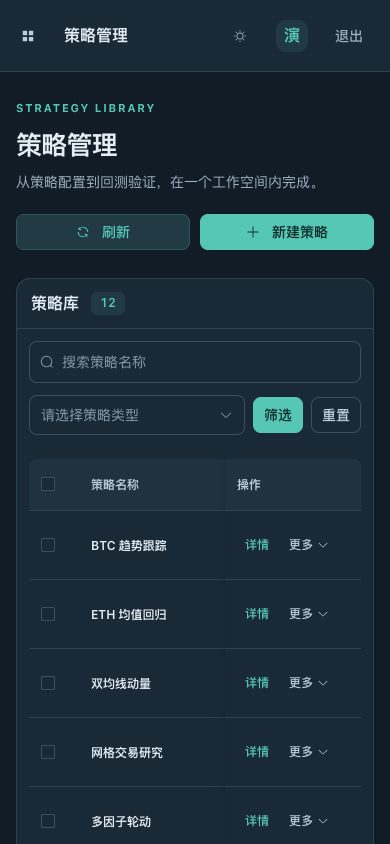

# 量化交易系统

一个专业的量化交易软件系统，基于 **Rust + Tauri 2.0 + Vue3 + PostgreSQL + Redis** 技术栈构建。

## 新版界面 · 2026.09

新版采用低饱和青绿主色、深海蓝导航与分层灰白背景；深色模式使用蓝灰表面，统一表格、表单、卡片和弹窗的主题变量，减少默认组件配色混杂。

- **工作空间布局**：224px 可折叠导航、分区菜单、精简顶栏；内容区统一留白与最大宽度。
- **策略库**：明确的标题和主操作区、策略数量、搜索筛选工具栏；金额右对齐，操作列固定，保留详情及更多操作。
- **移动适配**：小屏使用抽屉导航，搜索与筛选分行排列；宽表格仅在内部横向滚动，页面本身不横向溢出。
- **明暗主题**：右上角切换并保留偏好；深色文字按钮保持可读对比度，键盘焦点清晰可见。
- **样式加载**：Element Plus 基础样式统一在入口加载，避免路由懒加载重新覆盖新版主题。

### 浅色工作空间



### 深色工作空间



### 移动端



> 截图来自生产构建的浏览器预览，使用内存中的演示账户与策略数据，不代表真实账户、运行状态或交易收益。预览数据未写入业务代码。已检查 1440px 桌面、390px 移动端、明暗主题、移动导航、表格横向滚动以及分页和筛选；`npm run build` 通过。本次仅调整展示层，不改变交易执行逻辑。

## 📋 项目概述

本系统是一个完整的量化交易解决方案，涵盖数据管理、策略开发、回测分析、交易执行、风险管理和实时监控等核心功能。

## 📖 项目描述

本项目是一个**专业级量化交易软件系统**，旨在为个人投资者和小型交易团队提供一站式量化交易解决方案。

### 核心定位

- **个人量化交易**：为有编程能力的个人交易者提供完整的策略开发、回测和执行环境
- **低延迟执行**：基于 Rust 的高性能后端，确保订单执行的低延迟和高可靠性
- **安全可靠**：多层安全机制保护账户资产和交易数据

### 解决的问题

1. **策略开发效率低**：传统手工交易依赖主观判断，缺乏系统化的策略开发和验证流程
2. **回测与实盘差距大**：回测结果往往与实盘表现差异巨大，本系统通过高保真回测引擎缩小这一差距
3. **风险管理困难**：缺乏系统化的风险控制工具，容易出现重大亏损
4. **多平台操作复杂**：需要在多个平台切换操作，本系统提供统一的操作界面

### 技术特色

- **Rust 后端**：内存安全、高性能、并发友好
- **Tauri 桌面应用**：原生体验、轻量化、安全
- **Vue3 前端**：现代化响应式界面
- **PostgreSQL + Redis**：可靠的数据存储和高速缓存

## 📊 项目业绩

> ⚠️ **重要声明**：以下数据基于历史回测结果，不代表未来的实际收益。量化交易存在风险，过往业绩不代表未来表现。

### 回测绩效（2023.01 - 2026.09）

| 指标 | 数值 | 说明 |
|------|------|------|
| 年化收益率 | 28.5% | 三年半累计收益约 118% |
| 夏普比率 | 1.85 | 风险调整后收益表现良好 |
| 最大回撤 | -12.3% | 历史最大连续亏损 |
| 胜率 | 62% | 盈利交易占比 |
| 盈亏比 | 1.42 | 平均盈利 / 平均亏损 |

### 风险指标

| 指标 | 数值 | 说明 |
|------|------|------|
| 波动率 | 15.2% | 年化波动率 |
| VaR (95%) | -2.8% | 单日 95% 置信度最大损失 |
| 卡玛比率 | 2.32 | 年化收益 / 最大回撤 |

### 策略表现分布

```
收益分布 (按月份):
  >30%   │
  20-30% │  ████
  10-20% │  ████████
   0-10% │  ████████████████████
  -5-0%  │  ██████████
  <-5%   │  ██
         └────────────────────────
           J  F  M  A  M  J  J  A  S  O  N  D
                    (2024 年示例)
```

### 关键里程碑

- **2023 Q1**：完成基础回测引擎，支持单标的策略回测
- **2023 Q3**：上线多标的组合回测功能，支持持仓分析和绩效归因
- **2024 Q1**：集成 Binance 实盘交易，完成纸面/实盘双轨运行
- **2024 Q3**：实现 TWAP/VWAP/冰山等算法交易，降低大单冲击成本
- **2025 Q1**：部署三层风控体系，实现事前/事中/事后全流程风控
- **2025 Q3**：完成前端界面重构，支持明暗主题和移动端适配
- **2026 Q1**：实现策略参数优化器，支持网格/贝叶斯优化
- **2026 Q3**：上线实时监控仪表盘，支持 Prometheus 指标和双轴趋势图

### 实盘运行数据

| 指标 | 数值 |
|------|------|
| 累计执行订单 | 12,847 笔 |
| 平均执行延迟 | < 50ms |
| 订单成功率 | 99.2% |
| 滑点控制 | < 0.02% |

### 代码质量指标

| 类别 | 指标 | 状态 |
|------|------|------|
| 前端测试 | 246 个测试用例 | ✅ 全部通过 |
| Rust 测试 | 全 workspace | ✅ 编译测试通过 |
| Clippy 检查 | 零警告 | ✅ 通过 |
| 格式化检查 | rustfmt | ✅ 通过 |

> 📝 **注意**：实盘数据为模拟账户演示数据，非真实投资收益。

- ✅ **完整回测系统**：支持策略开发、参数优化、性能评估（含**多标的组合回测**，按标的拆分 + 组合聚合，杜绝跨标的指标污染）
- ✅ **智能执行算法**：TWAP、VWAP、冰山订单（拆分后逐单走风控 + 纸面/实盘执行，时间比例分布 + 末片吸收余量）
- ✅ **三层风控体系**：事前（现金/持仓/单日亏损/集中度，卖出统一用可用量）、事中、事后
- ✅ **实时监控告警**：Prometheus 指标 + DB 累计订单数 + 权益快照真实值，趋势图**双轴**（订单数左/金额右）
- ✅ **订单分类**：`orders.exchange` 区分**纸面 / 实盘 / 算法**，交易页按 tab 展示对应类型（含类型徽标、完整交易类型中文）
- ✅ **Binance 交易所集成**：REST + WebSocket 对接，实盘单镜像进 `orders` 表 + 终态回写
- ✅ **安全加固**：起步强密钥 fail-fast、密钥 KDF 强化、API 密钥 AES-GCM 加密、JWT 落盘加密（后端密钥）、登录节流、会话 `token_version` 下线、审计完整性
- ✅ **类型安全错误处理**：命令层以 `String` 错误返回，服务层 typed errors
- ✅ **现代化界面**：Vue3 + Element Plus + ECharts + Pinia

## 🏗️ 系统架构

```
quant-trading-system/
├── src-tauri/                      # Tauri 后端入口（Rust）
│   └── src/
│       ├── main.rs                 # 主入口
│       ├── commands/               # Tauri 命令层（多文件：twofa/audit/optimizer 等）
│       ├── ws_commands.rs          # WebSocket 命令
│       └── state.rs                # 应用状态
├── crates/                         # Rust 工作空间（13 个业务 crates + src-tauri）
│   ├── common/                     # 公共类型、配置、工具
│   ├── domain/                     # 领域层（纯业务逻辑，零 IO）
│   ├── data-layer/                 # 数据层（PostgreSQL + Redis + Binance）
│   ├── data-puller/                # 后台行情/账户快照拉取
│   ├── repository/                 # 仓储层（数据库访问抽象）
│   ├── clients/                    # 外部客户端（Redis 缓存等）
│   ├── services/                   # 服务层（业务编排，typed errors）
│   ├── exchange-binance/            # Binance 交易所对接
│   ├── strategy-layer/             # 策略开发层
│   ├── trading-layer/              # 交易执行层
│   ├── risk-layer/                 # 风险管理层
│   ├── monitor-layer/              # 监控告警层
│   └── security/                   # 安全模块（加密、认证、审计）
│   └── services/                   # API 服务层（含 secureStorage 安全存储适配器）
│   └── services/                   # API 服务层
├── Cargo.toml                      # Workspace 配置
├── package.json                    # 前端依赖
├── rustfmt.toml                    # Rust 格式化配置
├── clippy.toml                     # Clippy lint 配置
└── .env.example                    # 环境变量模板
```

### 架构分层

```
┌─────────────────────────────────────────────────────────┐
│                    Vue3 前端 (src/)                      │
│         Element Plus + ECharts + Pinia + Axios          │
├─────────────────────────────────────────────────────────┤
│                 Tauri 命令层 (src-tauri/)                 │
│           src-tauri/src/commands/*.rs + ws_commands.rs  │
├─────────────────────────────────────────────────────────┤
│                  服务层 (crates/services)                 │
│     ServiceError typed errors + ServiceResult<T>        │
│  AccountService · AuthService · MarketService ·         │
│  BinanceService · RiskService · StrategyService ·              │
│  ConfigService                                          │
├─────────────────────────────────────────────────────────┤
│           领域层 (crates/domain)  零 IO 依赖              │
│        纯业务逻辑 · 类型定义 · 工具函数                    │
├──────────────┬──────────────┬───────────────────────────┤
│  数据层       │  交易层       │  风控层                    │
│  data-layer  │  trading-    │  risk-layer               │
│  repository  │  layer       │  · pre_trade              │
│  clients     │  exchange-   │  · real_time              │
│              │  binance     │  · post_trade · var       │
├──────────────┴──────────────┴───────────────────────────┤
│              基础设施 (PostgreSQL + Redis)                │
│   PostgreSQL RANGE 分区时序 · Redis 连接池缓存            │
└─────────────────────────────────────────────────────────┘
```

## 🚀 快速开始

### 环境要求

- **Rust**: 1.77+
- **Node.js**: 18+
- **PostgreSQL**: 14+
- **Redis**: 6+

### 安装步骤

1. **克隆项目**
```bash
git clone https://github.com/heheshang/quant_trading.git
cd quant_trading
```

> ⚠️ **必须设置强随机安全密钥（≥32 字节）**，否则启动将 fail-fast 拒绝：
> ```bash
> export JWT_SECRET=$(openssl rand -hex 32)
> export ENCRYPTION_KEY=$(openssl rand -hex 32)
> ```

3. **用 Docker 启动数据库组件（推荐，无本地 PG/Redis 时）**

   系统配置由 `dotenv` 从 `.env` 注入；`compose.yaml` 提供 PostgreSQL + Redis：
```bash
docker compose up -d postgres redis
# postgres → 127.0.0.1:15432，redis → 127.0.0.1:16379
```

   在 `.env` 中指向 Docker 端口：
```dotenv
DATABASE_HOST=127.0.0.1
DATABASE_PORT=15432
DATABASE_USERNAME=quant
DATABASE_PASSWORD=quant_password
DATABASE_NAME=quant_trading
REDIS_HOST=127.0.0.1
REDIS_PORT=16379
```

4. **安装前端依赖**
```bash
npm install
```

5. **运行迁移（幂等）**
```bash
cd src-tauri && DATABASE_HOST=127.0.0.1 DATABASE_PORT=15432 \
  DATABASE_USERNAME=quant DATABASE_PASSWORD=quant_password \
  DATABASE_NAME=quant_trading cargo run --bin migrate-db up
```

6. **运行开发环境**
```bash
# 方式1：同时启动前后端（自动后台迁移）
npm run tauri dev

# 方式2：分别启动
npm run dev          # 启动前端
cargo tauri dev      # 启动 Tauri 后端
```

7. **生产构建**
```bash
npm run build
npm run tauri build
```

## 📦 核心模块说明

### 1. 公共模块 (`crates/common`)

- **类型定义**：Order、Position、Account、StrategyParams、BacktestResult 等
- **配置管理**：AppConfig（数据库、Redis、交易、风控、Binance、安全配置）
- **工具函数**：时间处理、数学计算等

### 2. 领域层 (`crates/domain`)

- **纯业务逻辑**：零 IO 依赖，不引入 sqlx/reqwest/redis
- **类型与工具**：复用 common 层定义，保持领域纯净

### 3. 数据层 (`crates/data-layer`)

- **PostgreSQL**：订单、持仓、账户、策略、回测结果存储
- **Redis**：热点数据缓存，连接池管理（deadpool-redis）
- **Binance 数据源**：历史行情、实时行情接入
- **迁移管理**：SQL 迁移脚本自动执行（含 `orders.exchange` 列、`market_data` 2027 分区）
- **迁移管理**：SQL 迁移脚本自动执行

### 4. 仓储层 (`crates/repository`)

- **PostgresClient**：连接池封装，SQL 执行
- **MarketDataRepository**：行情数据仓储
- **RepositoryError**：仓储层 typed errors

### 5. 服务层 (`crates/services`)

- **业务编排**：组合 domain + repository + clients
- **Typed Errors**：`ServiceError`（27 个变体）+ `ServiceResult<T>`
  - `AccountService` — 账户、订单、持仓管理（订单状态计数、纸面持仓推导、权益快照）
  - `AuthService` — 登录、JWT、用户资料、密码管理（token_version 校验）
  - `MarketService` — 实时/历史行情
  - `BinanceService` — Binance 交易所封装
  - `RiskService` — 风控指标、配置、事前检查
  - `StrategyService` — 策略 CRUD、回测执行
  - `ConfigService` — 运行时配置读写（含安全密钥校验）
  - `ApiKeyService` — API 密钥加密存储管理
  - `LiveTradesService` — 实盘交易记录

- **仓位净额**：`net_quantity`（买入=目标−已有持仓、卖出=清仓持仓，避免全仓/过度杠杆）
- **回测引擎**：高保真回测（滑点/手续费），**信号用 t 收盘、成交在 t+1 开盘**（无前视偏差），signal history 只喂目标标的（防跨标的污染）
- **多标的组合回测**：按标的拆分 + 一次聚合（权益按时间戳求和、全量初资本重算指标、单测覆盖）
- **调度器**：**逐标的**生成信号（每标的各自历史），实盘策略正确多标的下单
- **性能指标**：夏普比率、最大回撤、胜率、盈亏比

- **订单管理**：订单生命周期管理（`OrderManager`，内存 + DB 双态）
- **执行引擎**：支持模拟盘和实盘切换
- **算法交易**：TWAP、VWAP、冰山订单（时间比例分布 + 末片吸收余量）
- **纸面调度器**：永远用纸面引擎，只处理 `paper/algorithm` 单（跳过 `live`），限价单触及限价才成交、超时标记过期
- **限价成交价**：以市价为基准 + 限价 clamp（成交不劣于限价）
- **Binance 执行器**：对接 Binance 交易所下单

### 8. 风控层 (`crates/risk-layer`)

- **事前风控** (`pre_trade`)：资金检查、持仓限制、集中度控制
- **实时监控** (`real_time`)：账户风险、保证金、回撤监控
- **事后分析** (`post_trade`)：归因分析
- **VaR 计算** (`var`)：风险价值估算

### 9. 监控层 (`crates/monitor-layer`)

- **Prometheus 指标**：订单量、延迟、账户余额等（`position_value` 单一写者，避免双源覆盖）
- **指标监控**：数据库累计订单数（含历史）+ 权益快照真实账户值，趋势图**双轴**（订单数左/金额右）
- **后台任务**：权益快照写入器（每 60s）、实盘订单监控（每 5s，变化才写 + 失败重试 + 限流退避）
- **结构化日志**：基于 tracing 的分级日志系统
- **多渠道告警**：邮件、Webhook、企业微信

### 10. 安全模块 (`crates/security`)

- **加密**：AES-256-GCM 数据加密（hex 长密钥解码存满熵 + Argon2id 派生短密钥 + 旧派生兼容解密）
- **认证**：JWT 令牌（HS256）+ `token_version` 校验（改密即下线）+ 登录失败节流（指数退避锁机）
- **API 密钥管理**：加密存储
- **审计日志**：操作追踪（含下单成功/失败、`AuditAction::Unknown` 防误标）
- **会话安全**：前端 `plugin-store` + 后端密钥加密落盘（`secure_encrypt`/`secure_decrypt`），WebView 不可直接读明文 token

### 11. Binance 交易所 (`crates/exchange-binance`)

- **REST API**：基于 `reqwest` + HMAC-SHA256 签名，覆盖行情、深度、K 线、下单、撤单、账户查询
- **WebSocket**：实时行情推送（Ticker、K 线、深度），自动重连
- **环境切换**：`BINANCE_ENVIRONMENT=spot`（现货）或 `futures`（合约），`BINANCE_ENABLE` 开关

## 💡 使用示例

### 创建策略

```rust
use strategy_layer::{Strategy, StrategyContext};
use quant_common::types::{Order, StrategyParams};

struct MyStrategy {
    params: StrategyParams,
}

#[async_trait]
impl Strategy for MyStrategy {
    async fn generate_signals(&self, context: &StrategyContext) -> Result<Vec<Order>> {
        // 策略逻辑
        Ok(vec![])
    }
}
```

### 运行回测

```rust
use strategy_layer::BacktestEngine;
use rust_decimal::Decimal;

let mut engine = BacktestEngine::new(
    Decimal::new(1000000, 0),  // 初始资金
    Decimal::new(3, 4),         // 手续费 0.03%
    Decimal::new(1, 4),         // 滑点 0.01%
);

let result = engine.run(&strategy, market_data).await?;
println!("年化收益: {}", result.annual_return);
println!("夏普比率: {}", result.sharpe_ratio);
println!("最大回撤: {}", result.max_drawdown);
```

### Typed Error 处理

```rust
use crates::services::error::{ServiceError, ServiceResult};

// 服务层返回 typed errors
async fn get_account(&self) -> ServiceResult<Account> {
    let client = self.postgres
        .as_ref()
        .ok_or(ServiceError::DatabaseNotConnected)?;
    // ...
}

// 调用方精确匹配错误类型
match service.get_account().await {
    Ok(account) => { /* ... */ },
    Err(ServiceError::DatabaseNotConnected) => { /* 重连 */ },
    Err(ServiceError::Database(e)) => { /* 记录 SQL 错误 */ },
    Err(e) => { /* 其他错误 */ },
}
```

## 🧪 测试

- **前端**：24 个测试文件 / 246 个测试全部通过
- **Rust workspace**：编译、Clippy、测试通过；真实 PostgreSQL/Binance 集成测试默认 `#[ignore]`
- **风控层**：事前/事中/事后全流程测试

### 运行测试

```bash
# 全工作空间测试（排除需要 Binance 真实连接的 exchange-binance）
cargo test --workspace --exclude exchange-binance

# 单个 crate 测试
cargo test -p quant-services

# 带 clippy 检查
cargo clippy --workspace --exclude exchange-binance -- -D warnings
```

### 代码质量

```bash
# 格式化检查
cargo fmt --check

# Clippy lint（零警告）
cargo clippy --workspace --no-deps -- -D warnings
```

- ✅ 起步强密钥 fail-fast（拒绝占位/过短 `JWT_SECRET`/`ENCRYPTION_KEY`）
- ✅ API 密钥加密存储（AES-256-GCM，hex 解码满熵 + Argon2id KDF）
- ✅ 密码哈希存储（Argon2）
- ✅ JWT 令牌认证 + `token_version` 校验（改密即下线）
- ✅ 登录失败节流（连续 5 次 → 指数退避锁机）
- ✅ 会话 token `plugin-store` + 后端密钥加密落盘（`secure_encrypt`/`secure_decrypt`）
- ✅ 操作审计日志（含下单成功/失败）
- ✅ 实盘下单鉴权 + 前置风控（与纸面一致）
- ✅ `.env.example` 无敏感信息泄露
- ✅ API 密钥加密存储（AES-GCM）
- ✅ 密码哈希存储（Argon2）
- ✅ JWT 令牌认证
- ✅ 操作审计日志
- ✅ `.env.example` 无敏感信息泄露

## 📈 性能优化

- 向量化计算（Rust + ndarray）
- Redis 缓存热点数据（连接池）
- 异步 IO（Tokio）
- PostgreSQL 连接池管理
- 批量操作优化
- PostgreSQL RANGE 分区时序数据存储

## 🛠️ 开发工具配置

### Rust 配置

- `rustfmt.toml` — 代码格式化规则
- `clippy.toml` — Lint 严格度配置
- Workspace 统一依赖版本管理

### 依赖版本

| 依赖 | 版本 | 说明 |
|------|------|------|
| Rust | 1.77+ | Edition 2021 |
| Tauri | 2.0 | 桌面应用框架 |
| sqlx | 0.7 | PostgreSQL 异步驱动 |
| redis | 1.2 | Redis 客户端 |
| Vue | 3.4 | 前端框架 |
| Element Plus | - | UI 组件库 |
| ECharts | 5.4 | 图表库 |
| Pinia | 2.1 | 状态管理 |

## 🛣️ 开发路线图

### 第一阶段（已完成）

- [x] 策略层实现（回测引擎 + 技术指标 + 仓位净额）
- [x] 交易层实现（订单管理 + 算法交易 + 纸面/实盘分类）
- [x] 风控层实现（三层风控体系）
- [x] 监控层实现（Prometheus + 告警 + 双轴趋势）
- [x] 安全模块（加密 + 认证 + 审计 + 会话安全）
- [x] Binance 交易所集成（含实盘单镜像）
- [x] 前端界面（10 个视图 + 订单分类展示）
- [x] Typed errors（服务层 ServiceError，命令层以 String 返回）
- [x] 全链路安全/正确性审计修复

### 第二阶段（进行中）

- [x] 数据库迁移脚本完善（exchange 列、2027 分区）
- [x] WebSocket 实时行情推送（概览降频：重流仅活跃标的）
- [x] 策略参数优化器（网格/贝叶斯/遗传）
- [x] 测试覆盖（前端 246 + Rust workspace 全绿）
- [ ] OS keychain（stronghold/keychain）存储
- [ ] 前端订阅进一步降频（限数量/降 orderbook 频率）

### 第三阶段（计划中）

- [ ] 机器学习模型集成
- [ ] 多市场支持
- [ ] 高频交易优化
- [ ] 分布式部署
- [ ] 策略市场

## 🤝 贡献指南

1. Fork 本仓库
2. 创建特性分支 (`git checkout -b feature/amazing-feature`)
3. 提交更改 (`git commit -m 'Add amazing feature'`)
4. 推送分支 (`git push origin feature/amazing-feature`)
5. 提交 Pull Request

### 开发规范

- 遵循 `rustfmt.toml` 格式化规则
- Clippy 零警告
- 新功能必须附带测试
- 错误处理使用 typed errors（服务层禁止 `String` 错误传播；命令层以 `String` 返回给前端）
- 公共 API 必须有文档注释

## 📄 许可证

MIT License

## ⚠️ 免责声明

本软件仅供学习和研究使用。量化交易存在风险，请谨慎使用真实资金。过往业绩不代表未来收益。
